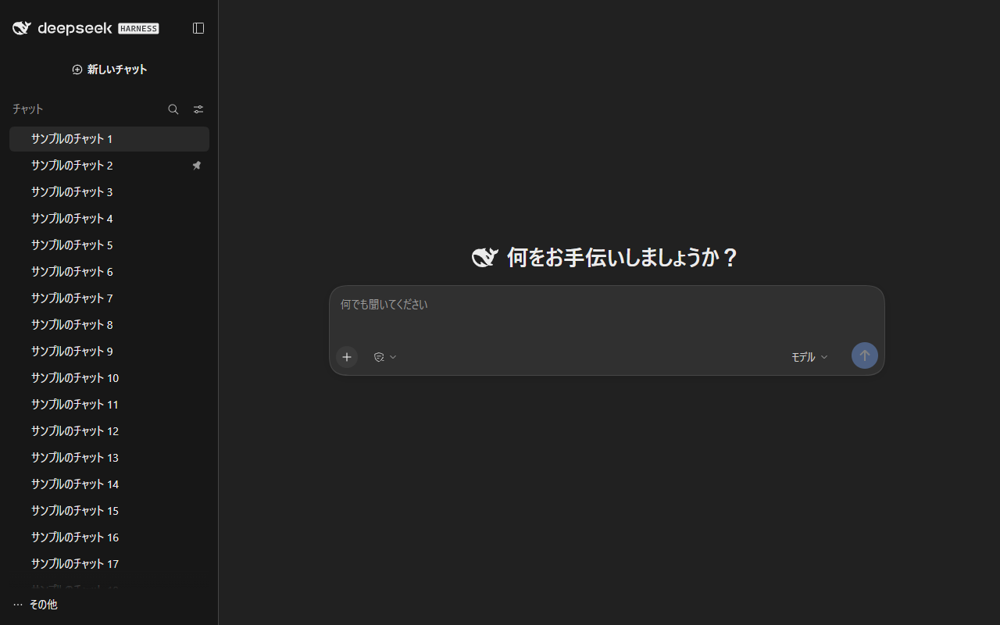
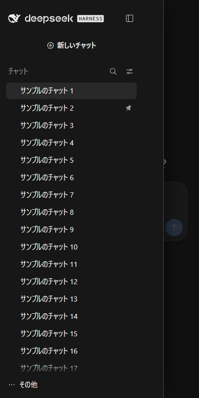

# dsh-chat-ui

[DeepSeek Harness](https://github.com/deepseek-ai/deepseek-harness)（DSH）の web UI を、
ChatGPT のような**チャット中心**の画面にするクライアントプラグインです。

DSH の web UI はワークスペースと開発者向けパネルが主体です。このプラグインは同じアプリを
「チャットの場」に寄せます。落ち着いた配色、更新順のフラットな履歴、右パネルなし、
ワークスペース選択なし、スマホではドロワー。そのうえで新しいチャットは**裏で 1 つの
作業フォルダ**に固定します。

| PC | スマホ |
|---|---|
|  |  |

```
サイドバー: ＋ 新しいチャット ・ 検索 ・ 履歴      中央: 見出し + 入力欄
```

## 変わること

| 場所 | 内容 |
|---|---|
| 配色 | `--dsw-*` トークンの上書きのみ（DSH の CSS は触らない）。地 `#212121` / サイドバー `#171717` / コンポーザ `#303030` / 文字 `#ececec` |
| ホーム | 見出しを「何をお手伝いしましょうか？」に。エージェントプリセットとプレビューのバッジは非表示 |
| サイドバー | 履歴は更新順のフラットな 1 リスト（DSH の「1 つのリスト」を既定に）。見出しは「チャット」 |
| 右パネル | 右サイドバー（実行の記録・ブラウザ・ファイル・ターミナル・ドキュメントプレビュー）と開閉ボタンを非表示 |
| 会話のヘッダー | ChatGPT と同じ 1 行（チャットの題名と `⋯`）。表示の切り替えタブ（チャット / 実行の記録）・フォルダを開くボタン・エージェントチームのチップは非表示。途中経過は会話の中（「リクエストを分析中」やツールの行）に出ます |
| 入力欄の下 | 数字の行（ターン・ステップ・トークン/秒、使用トークン・キャッシュヒット、文脈の使用率）は非表示 |
| ワークスペース | ツリー・選択・追加ボタンを非表示 |
| コンポーザ | アクセスモード（書き込み権限）は**アイコンだけ**、モデルは「**モデル**」表示。実名はホバー（title）と読み上げ（aria-label）で分かる |
| スマホ（≤768px） | 左のレールをドロワーに。ハンバーガー、背景クリック・Esc・遷移で閉じる。チャットは全幅。キーボードの操作は開いたドロワーの中に入り、閉じるとハンバーガーへ戻る |
| 作業フォルダ | 初回起動時に `$DSH_HOME/chat` を作成・登録し、新しいチャットを常にそこへ |
| 日本語 | 日本語の言語パックとフォント指定を同梱。ChatGPT 風の文言（「何をお手伝いしましょうか？」「新しいチャット」「チャット」）込み |

クライアントプラグイン＋小さなホスト側だけで動くので、外せば元の UI に戻ります。

## 必要なもの

- DSH `0.2.1-rc.5`（web プロファイル）
- Node.js 20 以上

## 導入

**はじめての人は [docs/quickstart.ja.md](docs/quickstart.ja.md)（5 分）** からどうぞ。

**2 コマンド＋再起動**です。設定ファイルも鍵も要りません。

```bash
# 1. 入れる（GitHub から）
dsh plugin --profile web add github:oda-blue/dsh-chat-ui

# 2. web を再起動
dsh web
```

表示された URL を開くと、サイドバーがワークスペースではなくチャット一覧になります。

- `dsh` が PATH に無い場合は、普段 DSH を起動している方法で:
  `npx @deepseek-ai/dsh plugin --profile web add ...` または
  `node <DSH のインストール先>/node_modules/@deepseek-ai/dsh/lib/bin.js plugin --profile web add ...`
  （`npx dsh` ではありません。npm の `dsh` は無関係のシェルです）
- オフライン / tarball（`npm pack` の出力や GitHub Releases）から:
  `dsh plugin --profile web add ./dsh-chat-ui-0.1.0.tgz`
- 手元のチェックアウトから: `dsh plugin --profile web add /absolute/path/to/dsh-chat-ui`
- **初回だけ** DSH の「プレビューについて」通知が出ます → **「続ける」** を 1 回押す

**入ったかの見分け方**: サイドバーの見出しが「チャット」で履歴がフラット、ホームの見出しが
「何をお手伝いしましょうか？」、会話画面の右上にパネルのボタンが無い。

**モデルの鍵や API 設定は含みません**。**設定 → モデル** で自分のプロバイダーを設定してください。

## 毎日の使い方

1. PC で入口を起動する（常駐します）
   `node <DSH_HOME>/profiles/web/node_modules/dsh-chat-ui/bin/web-entry.mjs --host lan`
2. ブックマーク `http://<PC名>.local:8123/` を開く（初回は DSH の通知を「続ける」）
3. スマホで同じ URL を開き、**入口の画面に出ている 8 桁のパスコード**を 1 回だけ入力する
4. スマホは**ホーム画面に追加**しておけば、アイコンから 1 タップで**アプリとして**開けます（下の「アプリとして使う」）

- 入口は**リバースプロキシ**なので、**URL は 8123 のまま変わりません**。
  token は URL に出ず、DSH への認証は入口が内部で行います（`--mode proxy`、LAN の既定）
- **PC 以外の端末は、パスコードで 1 回登録した端末だけ**が使えます（下の「安全のしくみ」）。
  この PC 自身（`127.0.0.1`）からはパスコード不要です
- **DSH 本体は 127.0.0.1 の 8125** で動き、LAN からは届きません。
  これまでの `:8124` は**入口への転送**として残しているので、古いブックマークや
  ホーム画面のショートカットもそのまま動きます
- `--host lan` は LAN の IPv4 を自動検出。`<PC名>.local` でも開けるので、
  DHCP で IP が変わってもブックマークが切れません（mDNS が通るネットワークで）
- PC とスマホで**同じ履歴・同じセッション**を共有します（DSH のホームは 1 つ）
- 毎回の起動が面倒なら、OS のスタートアップに上のコマンドを登録してください
- 従来の「302 で token 付き URL に飛ばす」方式（`--mode redirect`）は **この PC だけ（127.0.0.1）** で使えます。
  LAN では token を誰にでも渡してしまうため、起動を拒否します

## 作業フォルダ
起動時にホスト側が `$DSH_HOME/chat`（無ければ作成）を登録し、クライアント側が
新しいチャットをそこへ固定します。チャットが別々のプロジェクトフォルダに散らばりません。
別の場所にしたい時は、プロファイルのパッチ（`$DSH_HOME/profiles/web/cordis.patch.yml`）に書きます:

```yaml
- id: dsh-chat-ui
  name: dsh-chat-ui
  config:
    chatWorkspacePath: /absolute/path/to/chat
```

フォルダの名前は自由です。ホスト側がそのワークスペースの名前を **`chat (dsh-chat-ui)`** にし、
クライアント側はその名前のワークスペースへ新しいチャットを入れます（DSH ではワークスペースの名前が
重複しないので、たまたま `chat` という名前の別のプロジェクトフォルダを選ぶことはありません）。
`chatWorkspacePath` を変えた時は、次の起動で前のフォルダの名前が元に戻ります。

既存のチャットは元のフォルダのままです（新規チャットだけが対象）。

## 日本語 UI

日本語の言語パックとフォント指定を同梱しています（`locale/ja.json` を `client.js` に埋め込み）。

- 日本語の表示は **設定 → 一般 → 言語** で「日本語」を選びます
- 文言は ChatGPT 風（「何をお手伝いしましょうか？」「新しいチャット」「チャット」）
- Windows で漢字が中国語の字形になる問題を避けるため、日本語フォントを既定の先頭に置きます。
  設定でフォントを指定した場合はそちらが優先されます
- `@local/dsh-ja` など**別の日本語パックが既に入っている場合は、そちらを優先**します（二重登録しません）

訳を直すときは `locale/ja.json` を編集してから:

```bash
node tools/embed-ja.mjs          # client.js に埋め込み直す
node tools/embed-ja.mjs --check  # 埋め込み忘れの検出
```


## スマホから使う（固定 URL）

`dsh web` は起動のたびに token 付き URL を出します。同梱の入口は固定 URL で受けて、
DSH 本体へ中継します（LAN ではリバースプロキシ）:

```bash
# GitHub から入れた場合: プラグインが入っているプロファイルの bin を直接動かす
node <DSH_HOME>/profiles/web/node_modules/dsh-chat-ui/bin/web-entry.mjs --host lan

# npm に公開した場合
npx dsh-chat-ui --host lan

# この PC だけなら --host lan を外す（302 で token 付き URL へ転送する方式）
node .../bin/web-entry.mjs
```

`DSH_HOME` が環境変数に無い時は `--dsh-home <dir>` を足してください。

| ポート | 役割（`--host lan` の時） |
|---|---|
| `8123` | 入口。ブックマークするのはここ（`http://<PC名>.local:8123/` か `http://<LAN IP>:8123/`） |
| `8124` | 旧 URL の受け皿。開くと 8123 へ転送するだけ |
| `8125` | DSH 本体。`127.0.0.1` だけで待受け、LAN からは届かない |

- アダプタが複数ある時は `--host 192.168.1.23` のように明示してください。
- Windows ファイアウォールの許可を求められる場合があります。

### アプリとして使う（ホーム画面）

入口がアプリ用の設定（manifest）とアイコンを返すので、**「DSH チャット」**というアプリとして置けます。

| 端末 | 操作 | どうなるか |
|---|---|---|
| iPhone / iPad（Safari） | 共有 → **ホーム画面に追加** | アドレスバーの無い全画面で開きます。アプリ側は Safari と cookie が別なので、初回だけもう一度パスコードを入れます |
| Android（Chrome） | 下の設定を 1 回してから ⋮ → **アプリをインストール** | 独立したアプリとして開きます。設定しないと、入口が HTTP のため Chrome で開くショートカットにしかなりません |
| この PC（Chrome / Edge） | `http://127.0.0.1:8123/` を開き、アドレスバーのインストールのアイコン | 別ウィンドウのアプリになります |

manifest とアイコンは、ブラウザが cookie なしで取りに来るので登録前でも返します（秘密は含みません）。

**Android の 1 回だけの設定**: Chrome は安全な（HTTPS の）アドレスからしかアプリを入れません。家の中の入口を安全扱いにするよう Chrome に伝えます。

1. スマホの Chrome で `chrome://flags/#unsafely-treat-insecure-origin-as-secure` を開く
2. 入口のアドレスをカンマ区切りで入れ（例 `http://192.168.1.23:8123,http://<PC名>.local:8123`）、**Enabled** にする
3. **再起動**（Relaunch）を押し、入口を開いて ⋮ → **アプリをインストール**（「ホーム画面に追加」→「インストール」と出る版もあります。前に作ったショートカットは消しておく）

入れるのは入口のアドレスだけにしてください。PC の IP が変わったら書き換えます。

### 安全のしくみ（`--host lan` の時）

入口を通ると DSH を**持ち主と同じ権限**（ファイル操作・コマンド実行を含む）で使えるため、
入口は次の 2 つで守っています。

1. **他のサイトからは使えない**: 入口は、自分のアドレス（`<LAN IP>:8123`・`<PC名>.local:8123`・
   `127.0.0.1:8123`）宛ての要求だけを受け付け、別のサイトのページから来た要求（`Origin` /
   `Sec-Fetch-Site` が他サイト）は断ります。ヘッダーは書き換えずに DSH へ渡すので、
   DSH 本体の同じ検査もそのまま効きます。ブラウザで開いた悪意あるページが、裏で入口を
   操作することはできません。
2. **登録した端末しか使えない**: この PC 以外の端末は、最初に**8 桁のパスコード**を 1 回入力します。
   登録した端末には署名付きの cookie（HttpOnly・SameSite=Strict、約 400 日）が入り、以後は
   入力不要です。間違いは 10 分あたり 1 端末 5 回・全体 20 回までに制限しています。

- パスコードは入口の起動時の表示と `$DSH_HOME/dsh-chat-ui/entry-pairing.json` にあります
  （パッケージには含まれません）。
- 端末の登録をすべて取り消す・パスコードを変える時は `--reset-pairing` を付けて 1 回起動します。
- `<PC名>.local` と IP では別のアドレスとして扱われるので、両方を使う端末はそれぞれで 1 回登録します。
  iPhone はホーム画面から開いたアプリと Safari で cookie が別なので、ホーム画面側でもう一度聞かれることがあります。
- 家庭内 LAN 前提です。ポート開放・外部公開はしないでください。

## 戻し方

```bash
dsh plugin --profile web remove dsh-chat-ui
```

- 消えるのは配色・レイアウトの CSS と `data-dshgpt-*` 属性だけです。DSH 本体のファイルは触っていません。
- 履歴の並びはブラウザごとの設定（`localStorage["dsh.workspace.view.v5"]`）です。
  **表示オプション → グループ化 → ワークスペース** で戻せます。
- 作業フォルダの登録は `chat (dsh-chat-ui)` という名前で残ります。不要なら DSH 側で名前を変えるか削除してください。
- 右パネルは閉じた状態で残ります（プラグインが起動時に閉じ、DSH がそれを覚えるため）。右上のボタンで 1 回開けば戻ります。

## 困った時

| 症状 | 確認すること |
|---|---|
| 見た目が変わらない | スーパーリロード（Ctrl+F5）。プラグインは配信されますがブラウザがキャッシュすることがあります |
| 新しいチャットが別のフォルダに入る | `dsh web` を再起動（作業フォルダは起動時に用意されます）。`$DSH_HOME/storages/workspace.json` に `chat (dsh-chat-ui)` という名前で出ているか |
| 入口が 503 | `dsh web` の起動中。数秒後に再読み込み |
| 「この端末を登録」が出る | 入口の起動画面か `$DSH_HOME/dsh-chat-ui/entry-pairing.json` のパスコードを入力 |
| `forbidden (unknown host)` | ブックマークのアドレスが入口のもの（LAN IP・`<PC名>.local`・`127.0.0.1` の 8123）か確認。IP が変わった時は入口を再起動 |
| スマホから繋がらない | 同じ Wi-Fi か、IP が合っているか、入口ポートの受信が許可されているか |
| 真っ白 | ブラウザのコンソール。`uiWorkspace` / `workspaces` サービスが必要（web プロファイル専用） |

## ライセンス

MIT。DeepSeek 社・OpenAI 社とは関係ありません。"ChatGPT" は OpenAI の商標で、
ここでは見た目の説明のためにのみ使っています。
