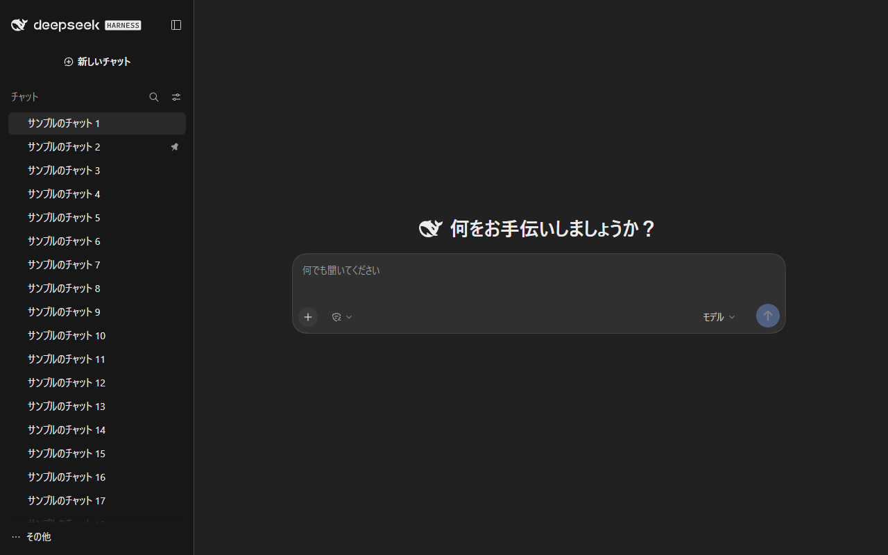
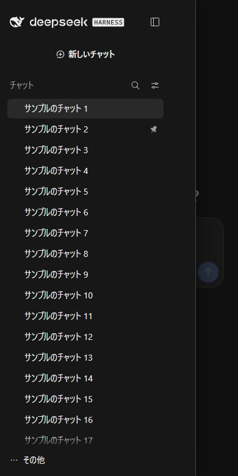

# dsh-chat-ui

A ChatGPT-style chat UI for the [DeepSeek Harness](https://github.com/deepseek-ai/deepseek-harness) (DSH) web client.

DSH's web UI is built around workspaces and developer panels. This plugin turns the same app into a chat-first surface: neutral palette, a flat chat history, no right-hand tool panel, no workspace pickers, and a phone-friendly drawer — while a new chat always runs in one fixed working folder in the background.

| Desktop | Phone |
|---|---|
|  |  |

```
sidebar: + New chat · Search · Chat list      main: headline + composer
```

## What it changes

| Area | Change |
|---|---|
| Palette | Overrides the `--dsw-*` design tokens only (no CSS file of DSH is edited): `#212121` canvas, `#171717` sidebar, `#303030` composer, `#ececec` text |
| Home | Headline "How can I help?", simpler composer; the agent-preset chip and preview badge are hidden |
| Sidebar | Flat chat list sorted by recency (DSH's "single list" grouping becomes the default), section titled "Chats" |
| Right panel | The right sidebar (execution log, browser, files, terminal, document preview) and its toggle are hidden |
| Conversation header | One row like ChatGPT: the chat title and the `⋯` menu. The view tabs (Chat / Execution log), the open-folder button and the agent-team chips are hidden. Progress still shows inside the chat ("Analyzing the request", tool steps) |
| Below the composer | The counters (turns / steps / tokens per second, token usage and cache hits, context usage) are hidden |
| Workspaces | The workspace tree, picker and add button are hidden |
| Composer | The access-mode chip (write permission) is an **icon only**; the model selector reads "**Model**". Both keep the real name in the hover title and aria-label |
| Phones (≤768px) | Left rail becomes a drawer with a hamburger button, backdrop, Esc/close-on-navigate; the chat takes the full width. Keyboard focus moves into the open drawer, stays there, and returns to the hamburger on close |
| Working folder | `$DSH_HOME/chat` is created and registered on first start; every new chat is created there |
| Japanese | A Japanese language pack and font order are bundled, with ChatGPT-style wording ("何をお手伝いしましょうか？", "新しいチャット", "チャット") |

Everything is a client plugin plus a small host half, so removing the plugin restores the stock UI.

## Requirements

- DSH `0.2.1-rc.5` (web profile)
- Node.js 20+

## Install

**New here? Start with [docs/quickstart.md](docs/quickstart.md) (5 minutes).**

> Installing from GitHub needs `git` on your PATH.

Two commands plus a restart:

```bash
# 1. install (GitHub)
dsh plugin --profile web add github:oda-blue/dsh-chat-ui

# 2. restart the web app
dsh web
```

That is the whole setup: no configuration file, no API key. Open the URL the app prints and the sidebar shows a chat list instead of workspaces.

- `dsh` not on your PATH? Use the install you already run DSH from, e.g.
  `npx @deepseek-ai/dsh plugin --profile web add ...` or `node <dsh-install>/node_modules/@deepseek-ai/dsh/lib/bin.js plugin --profile web add ...`.
  (Not `npx dsh`: the npm package named `dsh` is an unrelated shell.)
- Offline or from a tarball (`npm pack` output / GitHub release):
  `dsh plugin --profile web add ./dsh-chat-ui-0.1.1.tgz`
- Local checkout: `dsh plugin --profile web add /absolute/path/to/dsh-chat-ui`
- The first launch shows DSH's own "preview" notice — click **Continue** once.

**How to tell it worked:** the sidebar header reads *Chats* (with a flat history), the home headline is "How can I help?", and there is no panel button in the top-right corner of a conversation.

No model or API configuration is included: add your own provider key in **Settings → Models**.

## Daily use

1. Start the entrance on the PC (it stays running):
   `node <DSH_HOME>/profiles/web/node_modules/dsh-chat-ui/bin/web-entry.mjs --host lan`
2. On this PC, bookmark `http://127.0.0.1:8123/` (click **Continue** on DSH's first-run notice).
   Opening the `.local` or LAN address from the PC itself counts as another device and asks for the passcode
3. On the phone, open `http://<computer-name>.local:8123/` and enter the **8-digit passcode shown by the entrance** (once per device)
4. **Add it to the home screen** for one-tap access (it opens as an app; see *Use it as an app* below)

- The entrance is a **reverse proxy**, so **the URL never changes** (always `:8123`). The token never
  appears in the address bar; the entrance authenticates to DSH internally (`--mode proxy`, the LAN default)
- **Only devices paired with the passcode** can use it (see *How it stays safe* below).
  This PC itself (`127.0.0.1`) needs no passcode
- **DSH itself runs on 127.0.0.1:8125** (`--port` + 1) and is unreachable from the LAN. The old `:8124` stays
  as a **redirect to the entrance**, so existing bookmarks and home-screen shortcuts keep working
- `--host lan` picks the LAN IPv4 automatically, and the entrance also answers on
  `<computer-name>.local`, so the bookmark survives a DHCP address change (on networks with mDNS)
- PC and phone share the same history and sessions (one DSH home)
- To avoid starting it by hand, add the command to your OS startup items
- The older behavior (`--mode redirect`, a 302 to the token URL) is available **on this PC only (127.0.0.1)**.
  On a LAN address it is refused, because it would hand the token to anyone on the network

## Working folder

On start, the host half registers `$DSH_HOME/chat` (created if missing) and the client pins new chats to it, so chats never scatter across unrelated project folders. To use another folder, add this to your profile patch (`$DSH_HOME/profiles/web/cordis.patch.yml`):

```yaml
- id: dsh-chat-ui
  name: dsh-chat-ui
  config:
    chatWorkspacePath: /absolute/path/to/chat
```

Any folder name works. The host half titles that workspace **`chat (dsh-chat-ui)`** and the client pins new chats to the workspace with that title (DSH keeps titles unique, so another project folder that happens to be called `chat` is never picked). When you change `chatWorkspacePath`, the previous folder gets its own name back on the next start.

Existing sessions keep their original folders; only new chats are pinned.

## Japanese UI

A Japanese language pack and font settings are bundled (`locale/ja.json`, inlined into `client.js`).

- Choose **日本語** under **Settings → General → Language**
- The copy follows the ChatGPT style ("何をお手伝いしましょうか？", "新しいチャット", "チャット")
- Japanese fonts come before the Chinese ones in the default font list, so Windows does not render kanji with Chinese glyphs; a font chosen in Settings still wins
- If another Japanese pack (such as `@local/dsh-ja`) is already installed, it takes precedence and the bundled one stays inactive

To change a translation, edit `locale/ja.json`, then:

```bash
node tools/embed-ja.mjs          # re-embed into client.js
node tools/embed-ja.mjs --check  # detect a stale embed
```

## Phone access (fixed URL)

`dsh web` prints a URL with a new token on every start. The bundled entrance serves a stable URL and relays to DSH (a reverse proxy on a LAN address):

```bash
# installed from GitHub: run the bin from the profile that has the plugin
node <DSH_HOME>/profiles/web/node_modules/dsh-chat-ui/bin/web-entry.mjs --host lan

# this PC only (skip --host lan; a 302 to the token URL)
node .../bin/web-entry.mjs
```

`<DSH_HOME>` is the `DSH_HOME` environment variable, or `~/.dsh` when it is not set (on Windows `C:\Users\<you>\.dsh`). Add `--dsh-home <dir>` only when DSH keeps its data somewhere else.

| Port | Role (with `--host lan`) |
|---|---|
| `8123` | The entrance. Bookmark this (`http://<computer-name>.local:8123/` or `http://<LAN-IP>:8123/`) |
| `8124` | Old URL catcher. It only redirects to 8123 |
| `8125` | DSH itself, on `127.0.0.1` only — unreachable from the LAN |

- If the machine has several adapters, pass an explicit address: `--host 192.168.1.23`.
- The Windows firewall may ask for permission on first run.

### Use it as an app (home screen)

The entrance serves its own web-app manifest and icons, so the chat can be added as an app named **DSH Chat** ("DSH チャット" in Japanese):

| Device | How | Result |
|---|---|---|
| iPhone / iPad (Safari) | Share → **Add to Home Screen** | Opens full-screen without the address bar. The app keeps its own cookies, so enter the passcode once more on first launch |
| Android (Chrome) | One-time setup below, then ⋮ → **Install app** | Opens as its own app. Without the setup Chrome only makes a shortcut that opens in the browser, because the entrance is plain HTTP |
| This PC (Chrome / Edge) | Open `http://127.0.0.1:8123/` → the install icon in the address bar | A separate app window |

The manifest and icons are served before pairing (browsers fetch them without cookies); they contain nothing secret.

**Android one-time setup.** Chrome installs apps only from secure (HTTPS) addresses. Tell Chrome that the entrance on your home network counts as secure:

1. Open `chrome://flags/#unsafely-treat-insecure-origin-as-secure` in Chrome on the phone
2. Enter the entrance addresses, comma-separated, e.g. `http://192.168.1.23:8123,http://<computer-name>.local:8123`, and set it to **Enabled**
3. Tap **Relaunch**, open the entrance, then ⋮ → **Install app** (some versions show **Add to Home screen** → **Install**; remove an old home-screen shortcut first)

Only list the entrance's own addresses. When the PC's IP changes, update the list.

### How it stays safe (with `--host lan`)

Through the entrance, DSH runs with **the owner's rights** (including file access and running commands), so the entrance enforces two things:

1. **Other websites cannot use it.** Only requests addressed to the entrance itself (`<LAN-IP>:8123`, `<computer-name>.local:8123`, `127.0.0.1:8123`, `localhost:8123`) are served, and requests coming from another site's page (a foreign `Origin`, `Sec-Fetch-Site: cross-site`, or a background `same-site` request from another port) are refused. Headers reach DSH unchanged, so DSH's own Host/Origin checks still apply. A malicious page open in a browser cannot drive DSH through the entrance.
2. **Only paired devices can use it.** Every device other than this PC enters an **8-digit passcode** once. Paired browsers get a signed cookie (HttpOnly, SameSite=Strict, about 400 days). Wrong guesses are limited to 5 per sending address and 20 overall per 10 minutes (then 429 until the window passes).

- The passcode is printed when the entrance starts and stored in `$DSH_HOME/dsh-chat-ui/entry-pairing.json` (never in this package).
- Start once with `--reset-pairing` to issue a new passcode and unpair every device.
- `<computer-name>.local` and the IP count as different sites, so a device that uses both pairs once for each. On iPhone, a home-screen app keeps cookies separate from Safari and may ask once more.
- Home LAN only — do not port-forward it.

## Reverting

```bash
dsh plugin --profile web remove dsh-chat-ui
```

- Only the palette/layout CSS rules and the `data-dshgpt-*` attributes go away; DSH's own files are untouched.
- The chat list grouping is a per-browser preference (`localStorage["dsh.workspace.view.v5"]`). Switch it back under **View options → Group by → Workspace**.
- The chat workspace stays registered under the title `chat (dsh-chat-ui)`; rename or delete it in DSH if you no longer need it.
- The right panel stays closed until you open it once with the button at the top right (the plugin closes it on start, and DSH remembers that).

## Troubleshooting

| Symptom | Check |
|---|---|
| Old look after install | Hard reload (Ctrl+F5); client plugins are served fresh but the browser may cache |
| New chats still land elsewhere | Restart `dsh web` (the host half sets the folder up on start); `$DSH_HOME/storages/workspace.json` should list the folder with the title `chat (dsh-chat-ui)` |
| Entrance shows 503 | `dsh web` is still starting; reload in a few seconds |
| "Pair this device" appears | Enter the passcode printed by the entrance (also in `$DSH_HOME/dsh-chat-ui/entry-pairing.json`) |
| `forbidden (unknown host)` | Use the entrance's own address (LAN IP, `<computer-name>.local` or `127.0.0.1`, port 8123). Restart the entrance after the IP changes |
| Phone cannot connect | Same Wi-Fi, correct LAN IP, and an inbound firewall rule for the entrance port |
| Blank page | Look at the browser console; the plugin needs `uiWorkspace` and `workspaces` services (web profile only) |

## Releasing a new version

1. Raise `version` in `package.json` (for example `0.1.1`) and commit
2. Tag it with the same number and push: `git tag -a v0.1.1 -m "dsh-chat-ui 0.1.1" && git push origin main v0.1.1`
3. The `release` workflow checks that the tag matches `package.json`, then attaches `dsh-chat-ui-0.1.1.tgz` to the GitHub release

## License

MIT. Not affiliated with DeepSeek or OpenAI; "ChatGPT" is a trademark of OpenAI and is used here only to describe the visual style.
